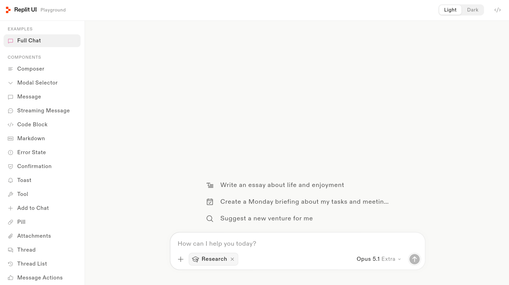

<p align="center">
  
</p>

<h1 align="center">replit_ui</h1>

<p align="center">
  📚 <a href="https://replit.asimawdah.com/">Documentation</a>
  · 🧩 <a href="https://replit.asimawdah.com/playground">Playground</a>
  · 📦 <a href="https://pub.dev/packages/replit_ui">pub.dev</a>
</p>

<p align="center">
Flutter UI library and optional streaming SDK for AI chat interfaces.
</p>



## Packages

This repository is a Dart pub workspace. `replit_ui` includes both the
model-neutral UI components and an optional streaming SDK.

| Package | What it is | Status |
|---|---|---|
| [`packages/replit_ui`](packages/replit_ui) | Chat UI components and optional streaming providers for Gemini, OpenAI-compatible APIs and Claude | [](https://pub.dev/packages/replit_ui) |

Also here: [`playground/`](playground), every component on a stage, hosted at [replit.asimawdah.com/playground](https://replit.asimawdah.com/playground); [`docs/`](docs), the site; [`contracts/`](contracts), the SDK wire contract.

## Development

```bash
flutter pub get                 # resolves the whole workspace
dart run melos run analyze
dart run melos run test
cd playground && flutter run -d chrome
```

Package docs: [replit_ui README](packages/replit_ui/README.md). Licensed under [MIT](LICENSE).
# replit_ui
