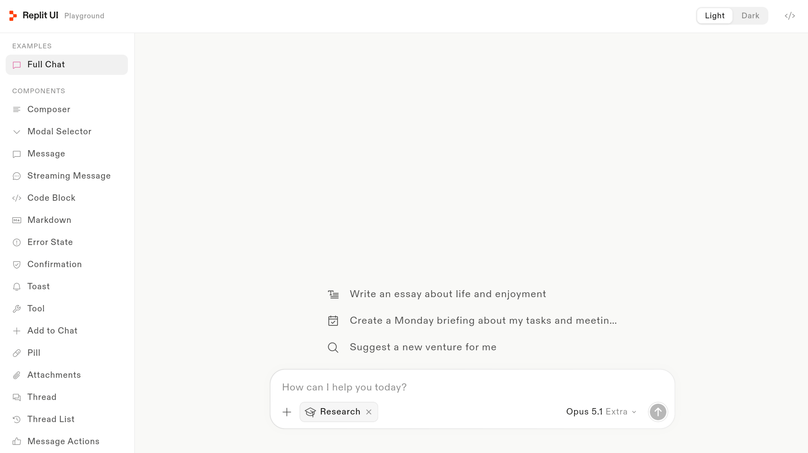

<p align="center">
  
</p>
<h1 align="center">replit_ui</h1>

<p align="center">
  <a href="https://pub.dev/packages/replit_ui"></a>
  <a href="https://pub.dev/packages/replit_ui/score"></a>
  <a href="https://github.com/asimawdah/replit_ui"></a>
  <a href="https://github.com/asimawdah/replit_ui/blob/main/LICENSE"></a>
</p>

<p align="center">
  📚 <a href="https://replit.asimawdah.com/">Documentation</a>
  · 🧩 <a href="https://replit.asimawdah.com/playground">Playground</a>
  · 🤓 <a href="https://pub.dev/documentation/replit_ui/latest/">API Reference</a>
  · 🗺️ <a href="https://replit.asimawdah.com/roadmap">Roadmap</a>
</p>

<p align="center">
<a href="https://replit.asimawdah.com/">Replit UI</a> is an open-source Flutter package for production-grade chat interfaces, with an optional streaming SDK.
</p>



> [!IMPORTANT]
> replit_ui is pre-1.0. The API is still settling, and minor releases may
> carry breaking changes — pin a minor version and read the
> [changelog](CHANGELOG.md) when upgrading.

## What's in the box

| Component | What it does |
|---|---|
| [`ReplitChatView`](https://replit.asimawdah.com/components/chat-view) | The full chat surface: bounded thread over a composer, centred at a readable width, with a zero state (greeting, lifted composer, starters), a jump-to-latest button, and drag-and-drop with a washed invitation overlay (web) |
| [`ReplitThread`](https://replit.asimawdah.com/components/message-thread) | Scrollable conversation: reads from the top, anchoring to the newest message once it outgrows the viewport; text selects across turns and copies with its line breaks |
| [`ReplitThreadList`](https://replit.asimawdah.com/components/thread-list) | Conversation history for a side panel — host-labeled sections, single selection by id, unread and pinned marks |
| [`ReplitMessage`](https://replit.asimawdah.com/components/message-thread) | One turn — ink-wash user bubble, plain assistant, error bubble, typed content parts |
| [`ReplitStreamingText`](https://replit.asimawdah.com/components/streaming-text) | Animated text reveal while a reply arrives |
| [`ReplitThinkingIndicator`](https://replit.asimawdah.com/components/thinking-indicator) | Animated Replit mark with a shimmering label |
| [`ReplitShimmerText`](https://replit.asimawdah.com/components/shimmer-text) | Sweeping text highlight, static once settled |
| [`ReplitCodeBlock`](https://replit.asimawdah.com/components/code-block) | Fenced code with built-in synchronous highlighting, a header label, and a copy affordance — languages host-extensible |
| [`ReplitMarkdown`](https://replit.asimawdah.com/components/markdown) | Assistant prose typeset from a built-in parser — headings, emphasis, lists, quotes, tables, links, and fences composing the code block; assistant turns render it by default and it streams gracefully |
| [`ReplitErrorState`](https://replit.asimawdah.com/components/error-state) | Failure card with a host-written message and retry pill — failed turns render it automatically |
| [`ReplitConfirmation`](https://replit.asimawdah.com/components/confirmation) | Approval card — an asterisk-marked request with approve and reject buttons that settles into the outcome; confirmation parts render it in a thread |
| [`ReplitToast`](https://replit.asimawdah.com/components/toast) | Floating notice: a glyph, one wrapping line and a cross on a frosted card; `showReplitToast` floats it in the nearest Overlay, stacked and auto-dismissing, with a handle to dismiss it early |
| [`ReplitTool`](https://replit.asimawdah.com/components/tool) | Tool-call card: one status mark that settles from a turning asterisk into a check or an error glyph, the call's title and primary argument, and its input and output behind a disclosure; tool parts render it in a thread |
| [`ReplitMessageActions`](https://replit.asimawdah.com/components/message-actions) | Copy / regenerate / edit / feedback row under a message |
| [`ReplitComposer`](https://replit.asimawdah.com/components/composer) | Multiline input with send/stop, attachments strip, the platform's file dialog (`showReplitAttachmentPicker` from your own menu, or a built-in attach button), image paste and card-scoped drop (web), and leading/trailing action slots; a full card, or a compact single-row pill that opens into it as the draft grows |
| [`ReplitMenu`](https://replit.asimawdah.com/components/menu) | Icon-triggered menu with groups, submenus, and toggles — anchored card on desktop, bottom sheet on phones |
| [`ReplitModelSelector`](https://replit.asimawdah.com/components/model-selector) | Model picker with effort and overflow submenus, sheet on phones |
| [`ReplitPill`](https://replit.asimawdah.com/components/pill) | Removable pill for an enabled tool or mode in the composer's action row — label auto-drops on phones |
| [`ReplitAttachmentGroup`](https://replit.asimawdah.com/components/attachments) | Image and file tiles with a type pill |
| [`ReplitAttachmentPreview`](https://replit.asimawdah.com/components/attachments) | Full-screen image viewer with zoom and paging |
| [`ReplitDropTarget`](https://replit.asimawdah.com/components/chat-view) | File-drop detection for any subtree (web) — decoded attachments out, hover state for your own treatment |
| [`ReplitSuggestion`](https://replit.asimawdah.com/components/suggestions) / [`ReplitSuggestionGroup`](https://replit.asimawdah.com/components/suggestions) | Prompt starters — plain or outlined; scroll, wrap, or column layouts |
| [`ReplitTheme`](https://replit.asimawdah.com/theming) | Design tokens (colors and typography) as a `ThemeExtension`, with light and dark presets |

## Getting started

```yaml
dependencies:
  replit_ui: ^0.4.0
```

Install the theme once (optional — without it, components fall back to a
preset matching the ambient brightness):

```dart
MaterialApp(
  theme: ThemeData(extensions: [ReplitTheme.light()]),
  darkTheme: ThemeData(
    brightness: Brightness.dark,
    extensions: [ReplitTheme.dark()],
  ),
)
```

Typography inherits the host app's text face and uses the platform monospace
face for code. Replit-branded apps can register their licensed Diatype files
in the app, set `ThemeData(fontFamily: 'Diatype')`, and select
`Diatype` and `Diatype Semi-Mono` with
`ReplitTypography.standard.withFontFamily(...).withCodeFontFamily(...)`.
The font is not bundled with this library.

```dart
ReplitTheme(
  colors: ReplitColors.light,
  typography: ReplitTypography.standard.withFontFamily('Inter'),
)
```

## Streaming chat

The package also includes an optional streaming SDK. UI-only apps can keep
using the components and callbacks above; apps using a bundled provider can
create a chat controller and render it with `UiDesignChatView`. The SDK is
distributed as part of `replit_ui`, so add `replit_ui` as your dependency and
import `package:replit_ui/replit_ui.dart`:

```dart
final chat = UiDesignChat(
  provider: GeminiProvider(
    apiKey: const String.fromEnvironment('GEMINI_API_KEY'),
  ),
);

@override
void dispose() {
  chat.dispose();
  super.dispose();
}

Scaffold(body: UiDesignChatView(chat: chat))
```

`GeminiProvider`, `OpenAIProvider` and `AnthropicProvider` are exported from
`package:replit_ui/replit_ui.dart`. The SDK handles streaming, cancellation,
retry, attachment history and tool calls; register app-owned actions with
`UiDesignChat(tools: ...)`. API keys compiled into a demo app can be extracted,
so public deployments should proxy provider requests through a server they own.

The package now depends on `http` for these opt-in provider adapters and
requires Dart 3.13 or newer. It adds no provider-specific permissions or
platform configuration, and no request is made unless the app uses a provider.

## Build a chat screen

Messages are pure view models. Your app maps its own transport into
`ReplitMessageData`, and streaming is data, not streams: while a reply arrives,
rebuild with `copyWith` carrying the grown text.

```dart
class ChatPage extends StatefulWidget {
  const ChatPage({super.key});

  @override
  State<ChatPage> createState() => _ChatPageState();
}

class _ChatPageState extends State<ChatPage> {
  final ScrollController _scroll = ScrollController();
  List<ReplitMessageData> _messages = const [];
  bool _generating = false;

  void _send(String text) async {
    final id = DateTime.now().microsecondsSinceEpoch.toString();
    setState(() {
      _messages = [
        ..._messages,
        ReplitMessageData.text(id: id, role: ReplitMessageRole.user, text: text),
        // An empty pending reply renders the thinking indicator.
        ReplitMessageData(
          id: '$id-reply',
          role: ReplitMessageRole.assistant,
          status: ReplitMessageStatus.pending,
        ),
      ];
      _generating = true;
    });

    // Feed chunks from your backend as they arrive.
    var streamed = '';
    await for (final chunk in myBackend.reply(text)) {
      streamed += chunk;
      setState(() {
        _messages = [
          ..._messages.sublist(0, _messages.length - 1),
          _messages.last.copyWith(
            parts: [ReplitTextPart(streamed)],
            status: ReplitMessageStatus.streaming,
          ),
        ];
      });
    }

    setState(() {
      _messages = [
        ..._messages.sublist(0, _messages.length - 1),
        _messages.last.copyWith(status: ReplitMessageStatus.complete),
      ];
      _generating = false;
    });
  }

  @override
  Widget build(BuildContext context) {
    return Scaffold(
      body: ReplitChatView(
        empty: _messages.isEmpty,
        greeting: const ReplitGreeting(
          icon: Icons.wb_twilight,
          text: 'Good afternoon',
        ),
        suggestions: ReplitSuggestionGroup(
          layout: ReplitSuggestionLayout.column,
          suggestions: [
            ReplitSuggestion(
              label: 'Write an essay about life and enjoyment',
              icon: Icons.edit_note,
              onTap: () => _send('Write an essay about life and enjoyment'),
            ),
            ReplitSuggestion(
              label: 'Create a Monday briefing from my tasks',
              icon: Icons.event_available,
              onTap: () => _send('Create a Monday briefing from my tasks'),
            ),
          ],
        ),
        thread: ReplitThread(
          messages: _messages,
          controller: _scroll,
          thinkingLabel: 'Thinking…',
        ),
        threadController: _scroll,
        jumpToLatestTooltip: 'Jump to latest',
        composer: ReplitComposer(
          placeholder: 'How can I help you today?',
          isStreaming: _generating,
          onSend: _send,
          onStop: myBackend.stop,
          sendTooltip: 'Send',
          stopTooltip: 'Stop',
        ),
      ),
    );
  }
}
```

`ReplitChatView` is body-only — it builds no `Scaffold` and no app bar, so
your app keeps the chrome, the background, and the keyboard inset. See
[`example/lib/main.dart`](example/lib/main.dart) for a complete runnable
version of this page, and the [live playground](https://replit.asimawdah.com/playground)
for a demo of every component with variants and code snippets.

## Composer accessories

The composer takes leading and trailing action slots. Drop in a `ReplitMenu`
(attachments, toggles) and a `ReplitModelSelector` — both render an anchored
card on wide layouts and a bottom sheet on phones:

```dart
ReplitComposer(
  onSend: _send,
  leadingActions: [
    ReplitMenu(
      icon: Icons.add,
      tooltip: 'Add to chat',
      entries: const [
        ReplitMenuOption(id: 'files', icon: Icons.attach_file, label: 'Add files'),
        ReplitMenuDivider(),
        ReplitMenuOption(id: 'web', icon: Icons.public, label: 'Web search', selected: true),
      ],
      onSelected: _handleMenu,
    ),
  ],
  trailingActions: [
    ReplitModelSelector(
      models: const [
        ReplitModelOption(id: 'fast', label: 'Fast', description: 'Quick answers'),
        ReplitModelOption(id: 'smart', label: 'Smart', description: 'Hard problems'),
      ],
      selectedId: _modelId,
      onSelected: (id) => setState(() => _modelId = id),
    ),
  ],
)
```

## Message content is typed parts

A message holds an ordered list of sealed `ReplitMessagePart`s —
`ReplitTextPart`, `ReplitAttachmentPart`, and `ReplitCustomPart` for anything the
package doesn't know about. Custom parts render through a builder you supply,
so hosts can inject arbitrary widgets (tool cards, citations, charts) without
forking the message renderer:

```dart
ReplitThread(
  messages: _messages,
  customPartBuilder: (context, message, part) {
    return switch (part.type) {
      'order-card' => OrderCard(order: part.data as Order),
      _ => null, // unknown parts are skipped
    };
  },
)
```

Attachments carry an `ImageProvider`, so network, file, memory, and asset
images all work. Build them yourself, or let the package hand them to you
ready-made — `showReplitAttachmentPicker` opens the platform's file dialog
from your own menu (or the composer's built-in button does), and on the
web the surface takes drops and the field takes pasted images:

```dart
ReplitMessageData(
  id: 'm1',
  role: ReplitMessageRole.user,
  parts: [
    ReplitAttachmentPart([
      ReplitAttachment(id: 'a1', thumbnail: NetworkImage(url), kind: 'JPG', label: 'sunset.jpg'),
    ]),
    ReplitTextPart('What do you think of this shot?'),
  ],
)
```

## Theming

`ReplitTheme` carries two token sets — colors and typography. Role names follow
Material 3's `ColorScheme`, so an existing scheme maps across, with one
addition: the design draws content at three ink levels (`onSurface`,
`onSurfaceVariant`, `onSurfaceMuted`) where M3 names two. Start from a preset
and override what your brand needs:

The light and dark presets follow the
[Replit brand palette](https://replit.com/brand): Replit Orange, Off White,
Off Black and warm grays. Typography carries the same tight headline
tracking, 130% body leading and tracked labels while inheriting the host app's
font, so the library does not redistribute the commercially licensed Diatype
files.

```dart
ReplitTheme(
  colors: ReplitColors.dark.copyWith(primary: const Color(0xFFFF764D)),
  typography: ReplitTypography.standard,
)
```

Spacing and corner radii are deliberately not tokens. Following Material's
structure, each component bakes its own metrics from the Replit UI design file
and exposes per-widget overrides (`padding:`, `borderRadius:`) where hosts
retheme. Strings shown to the user (tooltips, placeholders, labels) are
host-supplied, so localization stays in your app — the one exception, the
model selector's `effortLabel` and `moreModelsLabel` English defaults, is
overridable the same way.

## Docs & playground

Full documentation lives at [replit.asimawdah.com](https://replit.asimawdah.com/), and
every component has a stage in the
[live playground](https://replit.asimawdah.com/playground) — variant pills and
code snippets included. The playground is also
[in the repo](https://github.com/asimawdah/replit_ui/tree/main/playground) to run
locally:

```bash
cd playground && flutter run -d chrome
```

## License

Code is released under the [MIT License](LICENSE). The licensed Diatype font
is not included in this package.
